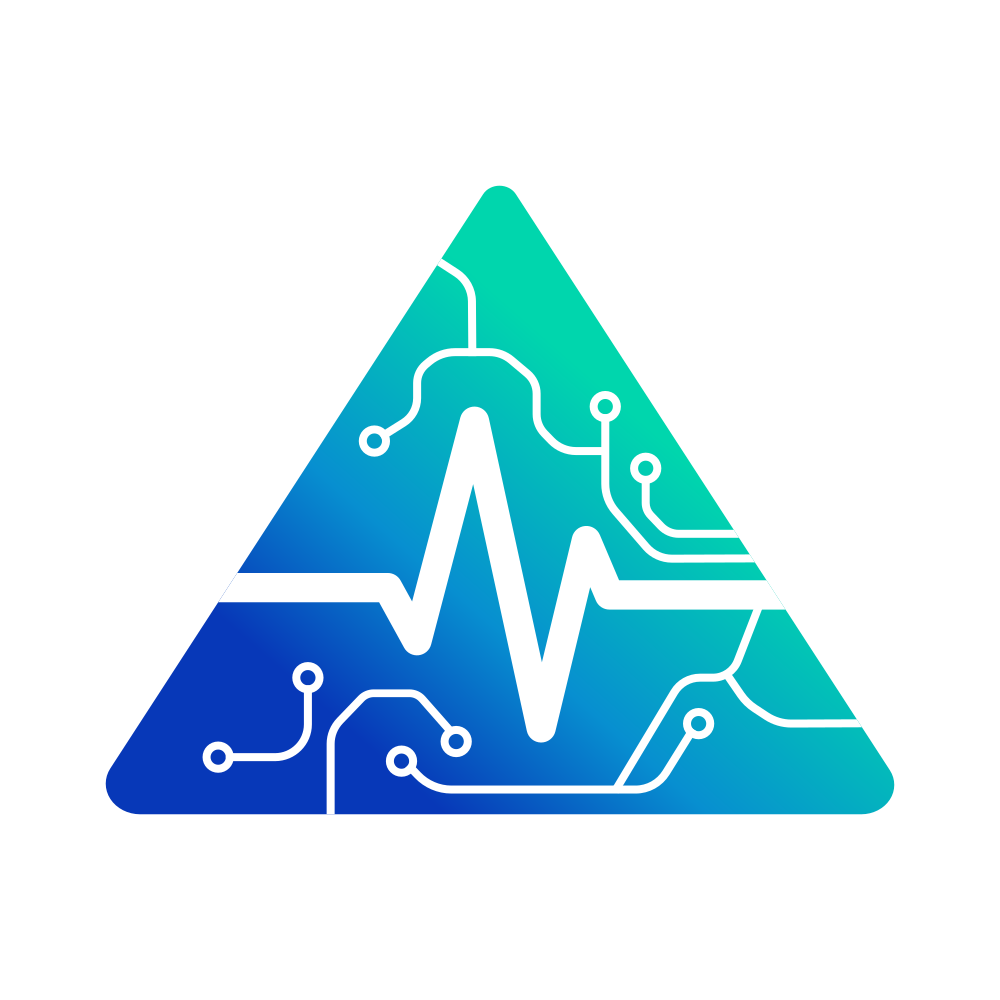

<h1 align="center">
  
  <big><big>TrIAderma</big></big>
</h1>

  <em>"Facilitar el triaje de los pacientes de dermatología con clasificaciones de gravedad y seguimientos potenciados con IA."</em>

---

TrIAderma es un proyecto orientado al triaje telemático de los pacientes en el ámbito de la dermatología, con el fin de aliviar la saturación que existe actualmente.

## Características Principales

* **Evaluación Visual Asistida:** Utiliza modelos de segmentación y detección de última generación para analizar el tamaño, color, profundidad y morfología de las lesiones cutáneas.
* **Seguimiento Continuo y Dinámico:** A diferencia de las herramientas de diagnóstico puntual, TrIAderma monitoriza la "pendiente de evolución" del paciente mediante notificaciones automáticas que solicitan nuevas capturas para comprobar si el tratamiento es eficaz.
* **Triaje Inteligente y Derivación:** Clasifica el estado de la afección y determina si el paciente requiere una telecita, una visita presencial prioritaria o si el caso puede resolverse de forma automatizada, ayudando a descongestionar las listas de espera en dermatología.
* **Informes Clínicos Completos:** Genera salidas estructuradas con mapas visuales de calor, comparativas temporales y correlaciones con analíticas previas para apoyar la toma de decisiones del personal médico.

## Marco Regulatorio y Ético

TrIAderma está concebido bajo el marco normativo de los sistemas de IA de alto riesgo en sanidad (*EU AI Act*), garantizando la transparencia algorítmica, la explicabilidad visual de los resultados y la supervisión médica constante en todo el proceso asistencial.

> *"En este repositorio se podrá observar la evolución del proyecto y cómo abordamos distintas cuestiones legales y éticas del mismo."*
> *"TrIAderma es un proyecto universitario teórico, este repositorio no tiene ninguna implementación y no sirve para ejercer el problema planteado."*
> *"Cualquier correo, número de telefono o dirección puede no ser real, solo mencionada para futura creación o uso."*

## Licencia

Todo el código fuente y los pesos (*checkpoints*) del modelo de **TrIAderma** se distribuyen bajo la licencia **Apache License 2.0**. 

Puedes utilizar, modificar y distribuir este software de forma libre, ya sea para fines de investigación o comerciales, siempre y cuando se incluya una copia de la licencia original y se respeten sus términos. Consulta el archivo `LICENSE` para más detalles.

---

## Aviso Médico y Descargo de Responsabilidad (Medical Disclaimer)
**TrIAderma es exclusivamente una herramienta de investigación y un Sistema de Soporte a la Decisión Clínica (CDSS).** 

Al utilizar este repositorio, código o modelo, aceptas explícitamente los siguientes términos:

1. **Uso no diagnóstico:** Este software no es un dispositivo médico certificado (MDR) y **no está diseñado para diagnosticar, curar, mitigar, tratar o prevenir ninguna enfermedad**. Los resultados de segmentación y análisis generados por la IA son meramente informativos.
2. **Supervisión obligatoria:** TrIAderma no sustituye, bajo ninguna circunstancia, el juicio clínico independiente de un profesional sanitario cualificado. Cualquier decisión clínica o tratamiento derivado del uso de esta herramienta debe ser validado y asumido por un médico colegiado.
3. **Ausencia de relación médico-paciente:** El uso de este software no establece ninguna relación médico-paciente entre los desarrolladores del proyecto y los usuarios finales o pacientes.
4. **Exención de responsabilidad ("AS IS"):** El software se proporciona "TAL CUAL", sin garantías de ningún tipo, expresas o implícitas, incluyendo, pero no limitándose a, la idoneidad para un propósito particular o la exactitud clínica. Los creadores y colaboradores de TrIAderma no asumen **ninguna responsabilidad legal o civil** por diagnósticos erróneos, negligencias, daños directos o indirectos, o mala praxis médica que pudiera derivarse del uso, sobreconfianza (*automation bias*) o mal uso de esta herramienta.
